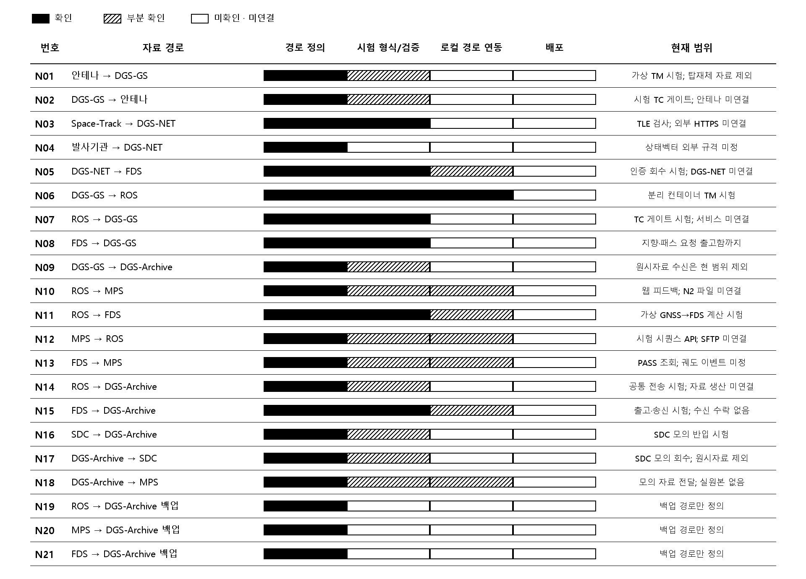

# N2 인터페이스별 개발 검증 현황

2026-10-25 기준. N01–N21 각각에 대해 **어디까지 시험 증거가 있는지** 네 칸 막대로 표시했다. 단계별 작업량이 다르므로 막대 길이를 백분율이나 남은 기간으로 해석하지 않는다.

| 칸 | 판정 기준 | 완전 확인 | 일부 확인 | 미확인 |
|---|---|---:|---:|---:|
| 1. 경로 정의 | 송신자·수신자와 자료 유형을 기록 | 21 | 0 | 0 |
| 2. 시험 형식/검증 | 해당 자료를 만드는 코드나 형식·무결성 검사를 시험 | 7 | 10 | 4 |
| 3. 로컬 경로 연동 | N2 양 끝단을 로컬 환경에서 연결해 시험 | 1 | 7 | 13 |
| 4. 배포 | 해당 N2 경로를 목표 VM 구성에 연결하고 실제 상대와 수락 시험 완료 | 0 | 0 | 21 |

검정 칸은 해당 단계의 시험 범위가 확인된 경우, 사선 칸은 일부 자료형이나 모의·대체 경로만 확인된 경우다. 빈칸은 아직 확인하지 못했거나 연결하지 않은 경우다. **2·3단계의 확인이나 시험 화면의 배포는 해당 N2 경로의 배포 완료와 다르다.**

N01·N02의 가상 장비 시험은 실제 안테나 연동이 아니다. N09의 원시자료와 S-band payload 수신은 현재 범위에서 제외했다. N10·N12의 웹/API 시험 흐름은 계획된 SFTP 파일 교환을 대체하지 않는다. N13은 접촉 일정 조회만 연결됐고 궤도 이벤트는 미정이다. N19–N21은 백업 방향만 정했으며 Archive 경유 백업 송수신은 시험하지 않았다.

각 막대의 상태·짧은 설명·근거 파일은 [`progress.json`](progress.json)에 기록했다. 인터페이스의 정확한 자료 방향과 전송 설계는 [N2 전체 표](README.md) 및 [`n2_chart.json`](../../interfaces/n2_chart.json)을 따른다. 그림은 [`render_n2_progress.py`](../../tools/render_n2_progress.py)로 다시 생성한다.
