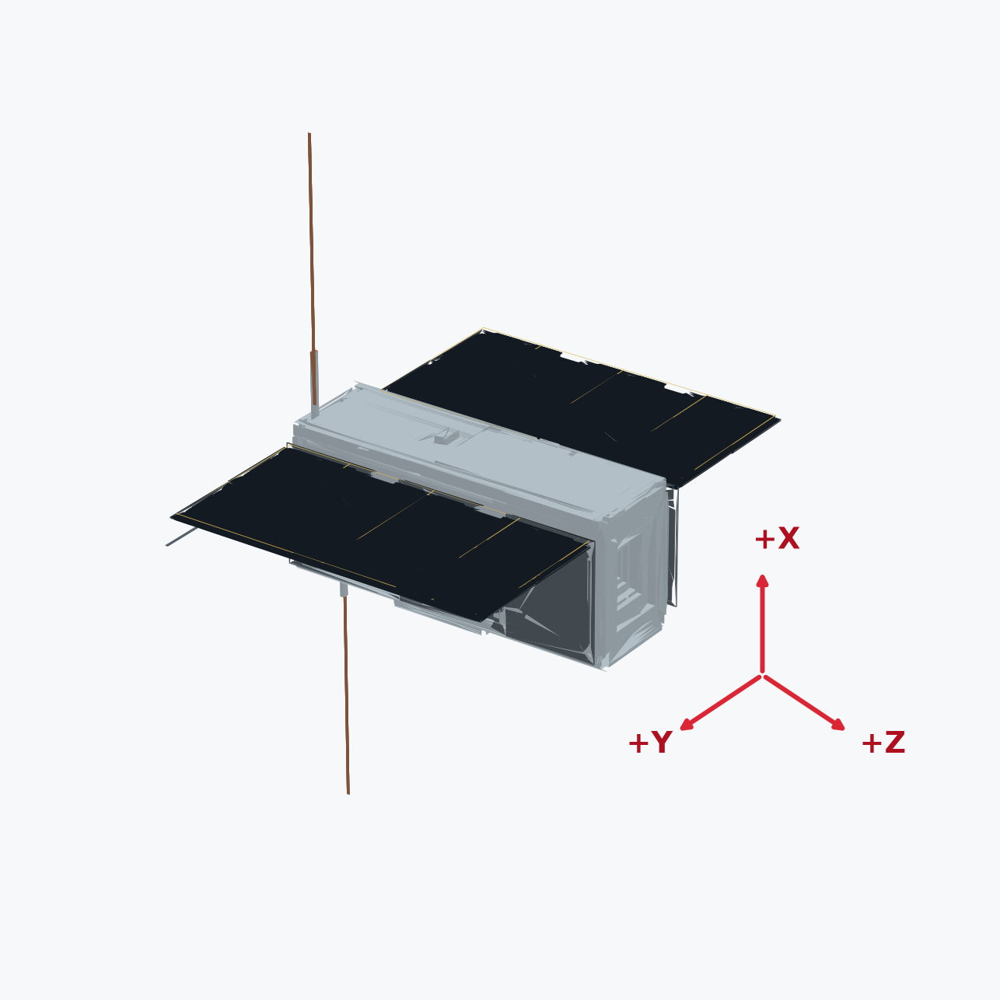

# ROS 위성 자세 뷰어의 CAD 모델

## 사용한 형상과 확인 결과

- 원본: `STCS-CAD-002. Deployed_v1.76 (2차 경연 기준).step`
- STEP 제품명: `PADOSAT_STCS_v1.76_mockup_step_12_deployed_full`
- 원본 SHA-256: `60c62187c59ae25d543f69dca859c6387006d9eaf5ffcb6026e5884fd574fbf6`
- 형식: STEP AP214, 단위 mm. 원본은 Git 저장소에 포함하지 않는다.
- 원본 형상에서 중앙 버스, 좌우로 전개된 태양전지판, 가는 안테나를 확인했다. 제공된 PADO-SAT 전개 형상 사진과 외형이 일치한다. 원본 제품명이 표시하듯 **v1.76 mockup**이며 운용 확정 형상으로 취급하지 않는다.
- 웹용 [메시](../web/assets/pado-sat-deployed-mesh.json)는 원본 STEP 표면을 삼각형으로 변환하고 화면 성능을 위해 축소한 것이다. 태양전지판 상면의 삼각형 결손을 메우기 위해 안쪽에 보조 면 4개와 얇은 화면용 구분선을 추가했다. 구조 해석이나 치수 측정에는 원본 STEP을 사용해야 한다.



## 좌표축과 색상

STEP 형상의 X 방향은 태양전지판의 면 법선, Y 방향은 전개 날개, Z 방향은 버스 장축과 일치한다. 제공된 좌표축 사진의 `+X` 위, `+Y` 좌하, `+Z` 우하 방향과 비교해 화면에서는 STEP XYZ를 기체 XYZ에 동일하게 대응했다. `cad_to_body`는 이 대응을 기록하며 메시 정점에는 이미 적용돼 있다. 뷰어가 행렬을 다시 적용하면 안 된다. STEP 안에는 CubeADCS body frame을 확정하는 주석이 없어 **축 부호와 센서 장착 방향의 최종 검증은 보류**한다.

현재 시뮬레이터 자세는 `body +Z nadir, +X along-track` 가정으로 생성되며 실제 비행 자세 및 탑재체 시선 정의와는 별개다. 화면의 `+Z`는 본체 축만 나타낸다.

ROS 화면은 CAD 위성 중심에 기체 X/Y/Z축의 원점을 고정하고 시점을 회전한다. 축이 시선과 거의 나란하여 선이 점으로 보이는 경우에는 원점에 화면 바깥쪽/안쪽을 뜻하는 점/십자 표식을 표시한다. 지구는 FDS 위치에서 계산한 방향과 겉보기 각반경에 따라 큰 구면 또는 지구 가장자리로 나타낸다. 표면에는 저장소에 포함된 Blue Marble 이미지를 사용한다. 태양은 FDS 방향의 밝은 천체로 나타내며 화면의 태양 크기와 CAD 크기는 실제 축척이 아니다. 유효한 자세 TM이 있을 때는 TM 쿼터니안과 같은 시각의 FDS 위치·태양 방향을 조합한다. 교신 구간 밖에서 시험 TM이 오래됐거나 없으면 합성 위성의 FDS 위치로 **nadir 예상 자세**를 그릴 수 있지만, 이는 수신된 위성 자세가 아니므로 화면에서 별도로 표시한다.

STEP에는 AP214 색상 레코드가 있지만 변환 과정에서 각 면에 색상을 안정적으로 대응할 수 없었다. 웹 메시의 검은 태양전지, 금색 테두리, 은색 본체, 구리색 안테나는 제공된 사진을 보고 재구성한 **화면용 색상**이다. 소재나 열광학 특성을 나타내지 않는다.

## 변환 재현

Python에 `cadquery-ocp==7.9.3.1.1`을 설치한 뒤 저장소 루트에서 실행한다.

```powershell
python tools/convert_step_to_ros_mesh.py "C:\path\to\STCS-CAD-002. Deployed_v1.76 (2차 경연 기준).step" web/assets/pado-sat-deployed-mesh.json
```

기본 STEP 삼각형 예산은 8,000개이며 현재 웹 메시에는 보조 면과 구분선을 포함해 8,032개가 들어 있다. 변환 스크립트는 원본 해시, 좌표계 근거, 색상 출처를 JSON 메타데이터에 기록한다. 원본이 개정되면 축 대응과 팔레트를 다시 검토한다.
