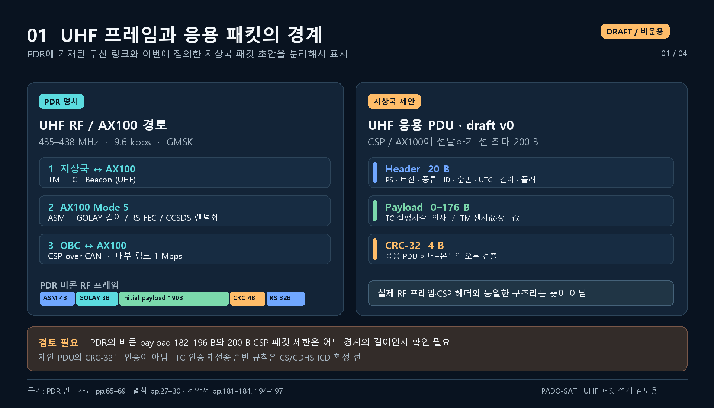
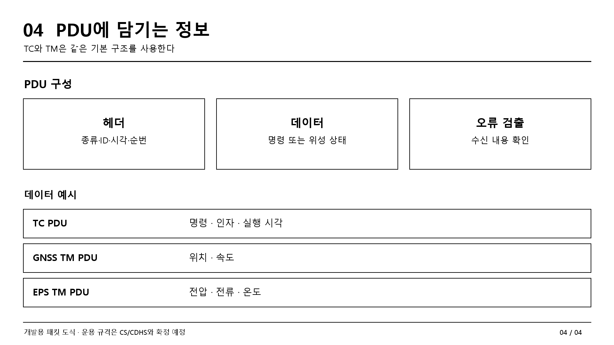
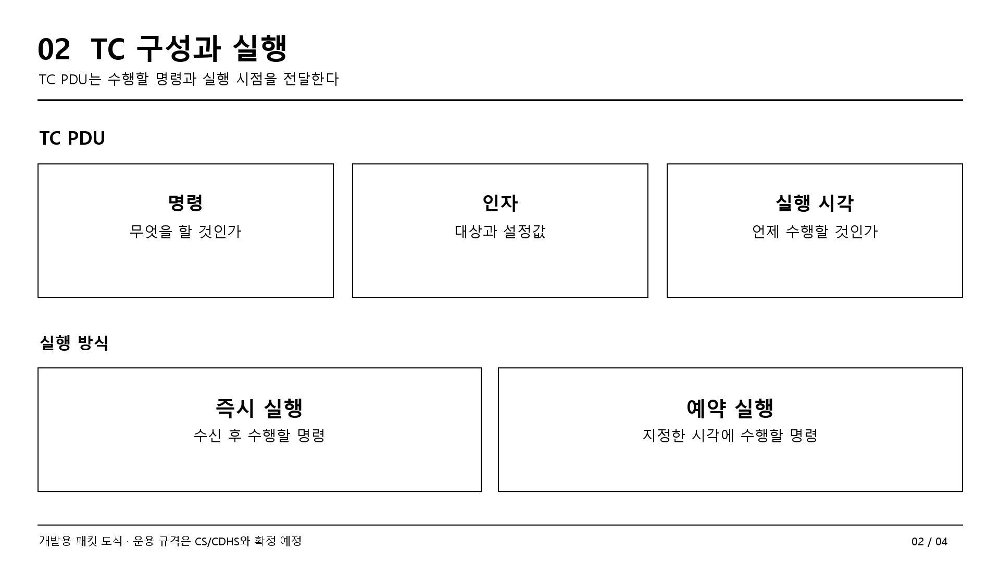
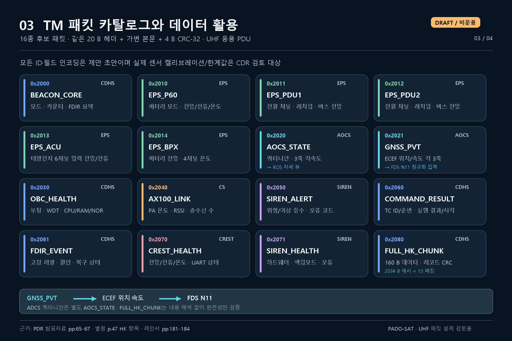

# PADO-SAT UHF TC/TM 패킷 설계 정리 — 검토 초안 v0

> **비운용 제안:** PDR의 CS·CDHS 자료에서 확인한 기능을 지상국 측 응용 패킷으로 구체화했다. 아래 숫자 ID와 바이트 배치는 비행 소프트웨어나 AX100의 승인 ICD가 아니다. 실제 송신과 운용 DB 등록은 CS·CDHS 승인 및 FlatSat 검증 뒤에만 가능하다.

## 핵심 결정

| 항목 | 지상국 초안 | 근거·한계 |
| --- | --- | --- |
| 범위 | UHF TC/TM 응용 PDU | S-band payload 수신·과학 데이터 해독은 제외 |
| TC | 후보 58종, 고정 인자가 정의된 36종만 초안 인코딩 | 명령 기능은 PDR, ID·인자 표현은 지상국 제안 |
| TM | 18종: GNSS, 자세, 노드 HK, 이벤트, 명령 결과, 시험 모드 비콘·식별 정보 | 필드·단위·센서 한계 승인 전 |
| 최대 크기 | 200 B: 헤더 20 + payload 최대 176 + CRC32 4 | CSP/AX100 헤더 포함 여부와 RF 비콘 예산 확인 필요 |
| 예약 명령 | TC payload 맨 앞 `execute_at_utc_ms` 8 B | OBC 큐·취소·만료·중복 규칙 미정 |
| 보호 | CRC32는 오류 검출 | 인증·재생 공격 방지는 미정, 운용 송신 금지 |
| 위치와 자세 | GNSS ECEF 위치/속도와 AOCS quaternion을 분리 | 실제 OEM719A→OBC TM 매핑 미확인 |

## 원본에 있는 사실과 제안의 경계

PDF 쪽수는 파일 자체의 페이지 번호다. 원본 PDF는 사용자 제공 자료이며 저장소에 복제하지 않았다.

| 출처 | 페이지 | 확인된 내용 |
| --- | ---: | --- |
| PDR 발표자료 | 65–67 | 즉시·예약 명령 개념, 1 Hz HK 수집, 모드 비콘 항목, CSP 노드 |
| PDR 발표자료 | 68–69, 73 | UHF TM/TC/Beacon, AX100 Mode 5 ASM+GOLAY/RS 무선 계층, FSW 명령 기능 목록 |
| PDR 별첨자료 | 27–30, 47 | CS·CDHS 요구, 1/60 Hz 코어 HK와 1/600 Hz 전체 HK 저장, 명령 인증 요구, 노드별 HK 필드 |
| PDR 제안서 | 181–184, 194–197 | CSP v1 주소, UHF 200 B 제한 제안, 모드 비콘 RF 길이와 다운링크 맥락 |

명령·HK 이름은 [`draft_v0.json`](../../interfaces/pado_packets/draft_v0.json)과 [`source_inventory.json`](../../interfaces/pado_packets/source_inventory.json)에 반영했다. 원본에는 **비행용 명령 ID, 정확한 인자 인코딩, 인증·ACK 프로토콜, 비콘 전체 바이트 맵, 센서 보정·한계값**이 없다. 상세 출처 해시와 설계 근거는 [인터페이스 설명](../../interfaces/pado_packets/README.md)에 있다.

PDR 별첨 47쪽의 OEM719A `BESTPOS`·`BESTVEL`·`BESTXYZ`·`TIME`은 장비 로그 이름이며 OBC의 다운링크 TM 바이트 구조는 아니다. PDR의 예비 질량·링크 버짓 수치·고각 가정은 TC/TM 응용 패킷을 정의하는 데 필요하지 않아 이 설계의 입력으로 사용하지 않는다.

## RF에서 응용 PDU까지

`안테나/RF → AX100 Mode 5 복조·FEC → CSP v1 → PADO 응용 PDU → ROS/MPS/FDS` 순서로 취급한다. ASM, GOLAY, RS는 PDR의 RF 맥락이며 지상국 초안 코덱이 생성하지 않는다. CSP 주소·포트도 실제 장비 계약이 필요하다. 아래 PDU CRC32는 RF FEC나 명령 인증을 대체하지 않는다.

| 오프셋 (B) | 길이 | 값·의미 |
| ---: | ---: | --- |
| 0 | 2 | ASCII `PS` |
| 2 | 1 | 초안 버전 `0` |
| 3 | 1 | 종류: `1` TC, `2` TM |
| 4 | 2 | 제안 TC/TM ID, big endian |
| 6 | 2 | 시퀀스, big endian |
| 8 | 8 | TC 발행 또는 TM 샘플 UTC Unix ms |
| 16 | 2 | payload 길이 |
| 18 | 1 | bit 7 = draft 필수, bit 0 = 예약 TC |
| 19 | 1 | 예약 필드 `0` |
| 20 | 0–176 | payload; JSON 카탈로그의 필드 순서 |
| 끝−4 | 4 | 헤더+payload에 대한 IEEE CRC32 |

정수와 IEEE-754 부동소수점은 big endian이며 암묵적 padding은 없다. TC payload는 `execute_at_utc_ms`(u64, 즉시는 0)부터 시작한다. `fields: null`인 22종은 인자 정의가 없어 코덱이 인코딩을 거부한다. 코덱은 잘못된 길이·CRC·예약 플래그·비정상 부동소수점도 거부한다.

## TC 목록

| 그룹 | 제안 ID 영역 | 기능 | 주의 |
| --- | --- | --- | --- |
| CDHS 모드·HK | `0x1001–0x1014` | 모드, safehold, HK 조회·주기·덤프 | 모드 값·사전 조건 승인 필요 |
| CDHS 추진·저장 | `0x1020–0x1078` | 추진 상태, 저장소·전송 | 추진·삭제 등 위험 명령 인자 대부분 보류 |
| EPS | `0x1030–0x1036` | 채널 전원, HK, heater | 장치·채널 번호 및 한계 필요 |
| CS | `0x1040–0x1047` | 비콘, 송신기, SRS, HK | 장비 접근·전파 조건 확인 필요 |
| AOCS | `0x1050–0x1056` | 모드, PVT, TLE, RTC, HK | PVT/리셋 인자 보류 |
| CREST | `0x1060–0x1064` | 전원·HK·상태 | science 데이터 경로 제외 |
| SIREN | `0x1080–0x1085` | 전원·추론·결과·HK | 모델/인자 계약 필요 |

위 표는 탐색용이다. **정확한 58개 TC의 ID, 이름, 필드, risk 표기는 JSON 카탈로그가 기준**이다. `risk`는 검토 우선순위이지 권한 부여가 아니다. `aocs_set_tle`에 TLE 두 줄을 담는 것은 제안일 뿐 실제 OBC 수용 증거가 없다. `COMMAND_RESULT`의 `command_id`·`command_sequence`로 명령과 응답을 연결하는 방식도 CDHS ACK 계약 확인이 필요하다.

## TM 목록과 사용처

| ID | 이름 | 핵심 내용·사용처 |
| --- | --- | --- |
| `0x2000` | `BEACON_CORE` | 모드·부팅·FDIR 요약. **RF 모드 비콘 완성본 아님** |
| `0x2001–0x2002` | `MODE_BEACON`, `BEACON_INFO` | 시뮬레이션용 장비 현재 상태·식별 문자열 |
| `0x2010–0x2014` | `EPS_P60`, `EPS_PDU1`, `EPS_PDU2`, `EPS_ACU`, `EPS_BPX` | 전압·전류·온도·채널·latchup 부분 HK |
| `0x2020` | `AOCS_STATE` | ADCS 상태, quaternion `q_w/x/y/z`, 3축 각속도; ROS 자세 화면 후보 |
| `0x2021` | `GNSS_PVT` | 수신 상태·나이·ECEF 위치/속도; 유효성 확인 뒤 FDS N11 후보 |
| `0x2030` | `OBC_HEALTH` | 부팅·reset·CPU/RAM/NOR·watchdog |
| `0x2040` | `AX100_LINK` | RF 보드 온도·RSSI·송수신 카운터 |
| `0x2050` | `SIREN_ALERT` | 경보·위험도·모델 버전 요약 |
| `0x2060–0x2061` | `COMMAND_RESULT`, `FDIR_EVENT` | 명령 결과 상관관계, 결함·복구 이벤트 |
| `0x2070–0x2071` | `CREST_HEALTH`, `SIREN_HEALTH` | payload 하드웨어 상태 요약; 과학 데이터 제외 |
| `0x2080` | `FULL_HK_CHUNK` | 저장 HK 레코드의 160 B 분할 전송 |

`GNSS_PVT` 위치·속도는 3축 직교 벡터이고 자세 quaternion과 별개다. 현재 변환기는 `solution_status=1`, `receiver_age_ms≤1000`, 궤도 범위 및 초 단위 시각을 요구한다. 이 수치는 **임시 지상국 판정**이며 OEM719A 로그에서 OBC까지의 실제 매핑은 확인되지 않았다. 전체 HK 2,034 B 레코드는 160 B 조각 13개로 나누고 레코드 CRC와 조각 메타데이터로 재조립한다. 레코드 내부 필드 해석은 미정이다.

PDR의 `sp_burn`은 CDHS 명령 후보 목록에만 남아 있고 인자가 미정이라 코덱과 MPS 후보 저장에서 거부한다. FDS는 이 명령을 읽거나 기동 궤적을 계산하지 않는다.

현재 시뮬레이터는 별도의 버전이 있는 전체 HK JSON을 `FULL_HK_CHUNK`에 담아
장비별 시험 파라미터를 제공한다. 이 자료는 위의 실제 2,034 B 레코드 바이트
구조와 구분한다. 추가된 비콘 묶음·원문 아카이브·ROS 화면은
[시뮬레이션 TM 안내](../SIM_TELEMETRY_PROFILE.md)에 기록했다.

## 코드·운용 상태

| 구성 | 현재 상태 |
| --- | --- |
| [초안 카탈로그](../../interfaces/pado_packets/draft_v0.json), [오프라인 코덱](../../tools/pado_packet_codec.py) | 비운용 encode/decode·길이·CRC·full HK 분할 및 GNSS→FDS 변환 |
| [GNSS 시험 브리지](../../tools/bridge_draft_gnss.py) | 검증된 초안 `GNSS_PVT` 바이너리 1개를 N11 시험 수신함의 본문+manifest로 게시. 실제 RF/OBC 디코더 아님 |
| [ROS 시험 TM 변환기](../../tools/preview_draft_tm.py) | 초안 TM 바이너리와 명시적 시험 한계표로 `TEST_ONLY_TM_SNAPSHOT` 생성·원자적 게시. 시뮬레이터는 그래프 대상 PDU를 최근 UTC 60분·계열별 최대 721개까지 메모리에 보관하고 ROS API 재검증 뒤 화면을 갱신. 임의 운용 한계 추정이나 장기 이력 보존 없음 |
| MPS 웹·시험 시퀀스 | 초안 58종 검색. 필드가 정의된 명령의 이름·순서·인자·PASS AOS 기준 시각 오프셋을 연세대 UHF PASS별 비운용 시퀀스로 저장. 미래 PASS의 저장본은 포털 재검증 후 ROS `SIM ONLY`로 명시적으로 전달 가능. 충돌 판정·운용 승인 없음 |
| ROS·가상 위성 TC/ACK | ROS의 별도 `SIM ONLY` 예약이 시각에 맞춰 허용된 읽기 전용 초안 TC를 비공개 Unix socket과 Docker 내부 TCP로 한 번 전송. 가상 위성 `COMMAND_RESULT` TM의 명령 ID·순번·결과를 확인해 예약 상태로 표시. 실제 승인·인증·RF 송출이나 자동 재전송 없음 |
| MPS/ROS 운용 명령·TM DB | 비어 있음. 실제 TC 송신과 미검증 TM 표시를 차단 |
| FDS | 검증된 GNSS N11 및 TLE 기반 궤도 예측 기능 존재; 기동 기능 없음. 실제 위성 GNSS TM 추출 경로는 미연결 |
| DGS-GS/AX100/FlatSat | 초안 PDU의 실제 링크·인증·ACK 검증 전 |

ROS 시험 화면에서 초안 패킷을 미리 보려면 [`preview_limits.example.json`](preview_limits.example.json)을 **시험 범위값으로만** 복사해, 실제 검토할 항목·한계로 바꾼다. `python tools/preview_draft_tm.py --test-only --limits <한계표.json> --out out/ros-tm-preview/test_tm_snapshot.json <TM1.pdu> <TM2.pdu>`로 게시하면 ROS 화면이 검증된 파일을 읽는다. `--out` 없이 표준 출력 JSON을 ROS의 수동 시험 TM 파일 선택기에 넣을 수도 있다. 범위값이 제공되지 않으면 센서 그래프를 생성하지 않는다. `python tools/bridge_draft_gnss.py --test-only <GNSS_PVT.pdu> <시험 N11 수신함>`은 N11 본문·매니페스트를 게시하며, 이후 기존 `receive_fds_inputs.py`가 이를 검증한다. 두 도구 모두 오프라인 PDU 입력 전용이다.

## 승인 전 확인할 사항

1. **CS:** AX100/CSP 실제 바이트 경계, 200 B 예산, CSP 노드·포트, FEC·CRC 위치, 비콘 182–196 B와의 관계.
2. **CDHS:** TC/TM ID·인자 폭·mode/device/channel 번호, UTC epoch·시퀀스 rollover, 예약 취소/만료/중복 규칙, 명령 결과·ACK 코드.
3. **CS·CDHS:** 우주선 명령 인증 범위·알고리즘·키 관리, 재생 공격 방지, 운영자 승인 규칙.
4. **CDHS·AOCS:** OEM719A 로그→OBC TM 매핑, 좌표계·시각·상태 비트, CubeADCS quaternion 정의·축 순서.
5. **각 서브시스템:** 실제 HK 단위·보정·한계값, 모드 비콘 필드, 전체 HK 저장 레코드 구조.
6. **통합 시험:** 양쪽에서 생성한 golden vector, AX100 수신 dump, ROS↔DGS-GS↔FlatSat 추적 로그. 승인된 항목만 운용 DB에 옮긴다.

프로젝트 전체 상태는 [진행 기록](../PROGRESS.md)에 남긴다. 그림은 [`tools/render_packet_diagrams.py`](../../tools/render_packet_diagrams.py)로 재생성한다.
