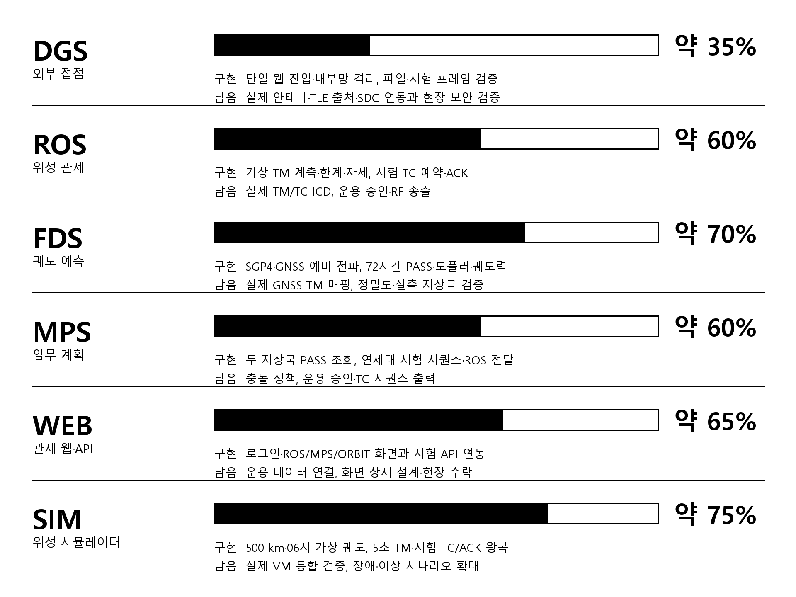

# 서브시스템별 개발 진행도

2026-10-25 기준의 **대략적인 기능 개발 추정치**다. 비운용 시험 기능과 목표 인터페이스까지 포함해 평가했으며, 실제 위성·외부 기관과의 운용 준비율은 아니다. 현재 범위에서 제외한 S-band 탑재체 원시자료 수신, NAS, FDS 궤도 기동은 분모에 넣지 않았다.

| 서브시스템 | 추정 | 구현·시험된 핵심 기능 | 남은 핵심 작업 |
|---|---:|---|---|
| DGS | 약 35% | 단일 웹 진입, 내부망 격리, 시험 프레임·파일 검증 | DGS-GS/NET/Archive 운용 서비스와 실제 외부 상대 연동, 현장 보안 검증 |
| ROS | 약 60% | 가상 TM 센서 그래프·한계·자세, 시험 TC 예약·ACK | 실제 TM/TC ICD, 운용 승인·서명 및 RF 송출 경로 |
| FDS | 약 70% | TLE/SGP4, GNSS 예비 수치 전파, 72시간 PASS·도플러·궤도력 | 실제 GNSS TM 매핑, 예측 정밀도와 실측 지상국 검증, 운용 입력 연결 |
| MPS | 약 60% | 두 지상국 PASS 조회, 연세대 UHF 시험 시퀀스 저장·ROS 전달 | 실제 충돌 정책, 운용 승인·TC 시퀀스 출력 및 상대 파일 연동 |
| 웹 | 약 65% | 로그인, ROS·MPS·ORBIT 화면과 시험 API 연동 | 운용 데이터 연결, 화면 상세 설계와 현장 수락 |
| 시뮬레이터 | 약 75% | 500 km·06시 가상 궤도, 5초 간격 TM, 시험 TC/ACK 왕복 | 실제 VM 통합 검증, 장애·이상 시나리오 확대 |

## 추정 기준

여섯 구성요소에 같은 가중치를 사용했다: **구조·계약 20%, 핵심 기능 40%, 로컬 연동·시험 20%, 실제 자료·현장 수락 20%**. 각 항목에서 확인된 범위를 평가해 합산하고 5% 단위로 반올림했다. 수치는 공수나 일정의 계측값이 아니며, 특히 실제 자료·현장 수락 항목은 여섯 구성요소 모두 아직 확인되지 않았다. 웹과 시뮬레이터는 다른 서브시스템을 지원하는 공통 구성요소이므로 수치를 서로 더하지 않는다. 산정 값과 근거 파일은 [`subsystem_progress.json`](subsystem_progress.json)에 기록했다.

[개발방향](PADO-SAT_지상국_개발방향.md), [진행 기록](PROGRESS.md), [9단계 화면·연결 상태](STAGE9_UI.md), [FDS 구현 안내](../services/fds/README.md), [N2 인터페이스 검증 현황](N2_ICD/PROGRESS.md)을 함께 참고한다. 이미지는 [`render_subsystem_progress.py`](../tools/render_subsystem_progress.py)로 다시 생성한다.
