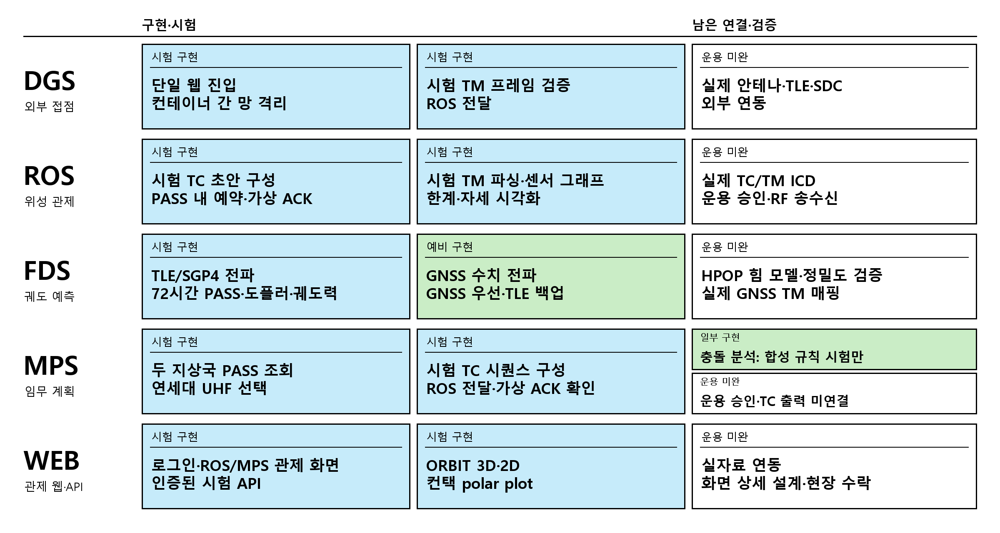

# 핵심 기능 개발 현황

2026-10-25 기준이다. 그림의 **시험 구현**은 합성 자료와 로컬 시험으로 기능을 확인했다는 뜻이며 실제 위성·외부 지상국을 통한 운용 완료를 뜻하지 않는다. **예비 구현**은 모델이 있으나 힘 모델 또는 예측 정밀도 검증이 더 필요한 상태다.

| 영역 | 현재 확인된 핵심 기능 | 남은 연결·검증 |
|---|---|---|
| DGS | 단일 웹 진입, 컨테이너 망 격리, 시험 TM 프레임 검증·ROS 전달 | 실제 안테나·외부 TLE·SDC 연동 |
| ROS | 시험 TC 초안 구성·PASS 내 예약·가상 ACK, 시험 TM 파싱·계측 그래프·한계·자세 표시 | 실제 TC/TM ICD, 운용 승인·RF 송수신 |
| FDS | TLE/SGP4 전파, GNSS 예비 수치 전파와 GNSS 우선·TLE 백업, 최대 72시간 PASS·도플러·궤도력 | HPOP 힘 모델·정밀도 검증, 실제 GNSS TM 매핑·지상국 실측 설정 |
| MPS | 두 지상국 PASS 조회, 연세대 UHF 시험 TC 시퀀스 구성·ROS 전달·가상 ACK 확인 | 합성 충돌 규칙 시험을 운용 정책에 맞춰 확장·연결, 운용 승인·TC 출력 |
| 웹 | 로그인·ROS/MPS·ORBIT 화면과 인증된 시험 API | 실자료 연동, 화면 상세 설계·현장 수락 |

FDS의 수치 전파를 **운용 HPOP 완료**로, MPS의 충돌 분석을 **전혀 미개발**로 표시하지 않았다. FDS는 GNSS 기반 예비 수치 전파가 있고 정밀 힘 모델과 검증이 남아 있다. MPS에는 합성 규칙의 C 시험 코드가 있으나 운용 자원·모드 정책과 현재 계획 흐름의 연결은 남아 있다.

그림 내용과 근거 경로는 [`core_feature_status.json`](core_feature_status.json)에 기록했다. [`render_core_feature_status.py`](../tools/render_core_feature_status.py)로 PNG를 다시 생성할 수 있다.
