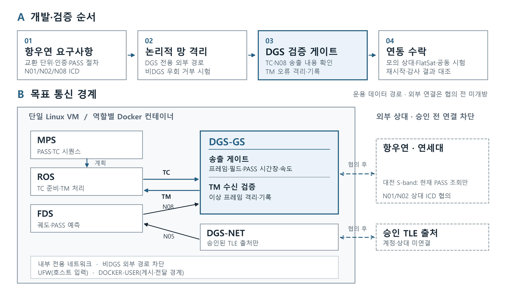

# 외부 연동·보안 개발 로드맵

**그림 설명.** (A) 항우연 연동 요구사항을 합의해 N01·N02·N08 계약을 확정한 뒤, 단일 Linux VM의 컨테이너별 통신 경로를 제한하고 DGS-GS의 TC·N08 송출 및 TM 수신 검증을 개발한다. 합성 입력·FlatSat·상대 기관 시험을 거쳐 실제 VM에서 우회 차단과 재시작 후 정책 유지를 수락한다. (B) ROS·MPS·FDS의 운용 외부 통신은 DGS를 거친다. DGS-GS는 승인 지상국으로 나가는 TC 프레임과 PASS·지향 자료를 검증하고, DGS-NET은 승인된 TLE 출처만 사용한다. UFW와 Docker `DOCKER-USER`는 주소·포트·전달 경계이며, 프레임과 명령 필드 검사는 DGS-GS 소프트웨어가 맡는다.

그림의 내부 화살표는 목표 자료 경로이고, 점선 외부 연결은 **협의 후 개방할 경로**다. 항우연·연세대의 실제 연동은 현재 미구현이며, 대전 S-band는 현재 PASS 조회 전용이다. 현재 단계 9의 DGS-OPS-Gateway 웹 진입과 합성 TC/TM 시험은 그림에 나타낸 운용 DGS-GS·DGS-NET 서비스와 다르다. 이 그림은 단일 VM 안의 **논리적 격리**를 나타내며 물리적 망분리를 뜻하지 않는다. S-band 탑재체 원시자료 수신과 DGS-Archive/SDC 후속 연동은 도식의 범위에서 제외했다.

[SVG 원본](향후계획_보안연동_로드맵.svg) · [고해상도 PNG](향후계획_보안연동_로드맵.png) · [재생성 코드](../tools/render_security_roadmap_figure.py)

근거: [현행 개발방향](PADO-SAT_지상국_개발방향.md), [N2 연결표](N2_ICD/README.md), [보안 계획서의 항우연 협의 의제와 TC/TM 검증](PADO-SAT_지상국_보안설계_개발방향계획서.md).
